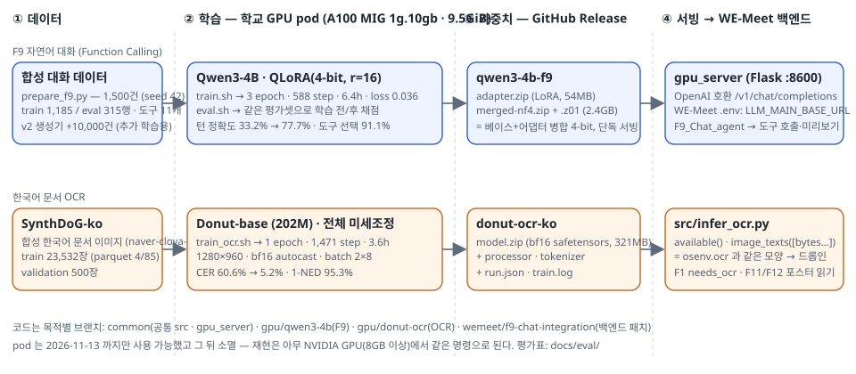

<h1 align="center">Univ-Us AI</h1>

<p align="center">
  <strong>대학생 일정 비서 WE-Meet(유니버스)에 들어갈 AI 를 외부 API 없이 직접 학습한다 —<br>
  F9 자연어 대화(Function Calling) 모델과 한국어 문서 OCR 모델을 학교 GPU 서버에서 미세조정해, OpenAI 호환 서버·드롭인 모듈로 백엔드에 붙인다</strong>
</p>

<p align="center">
  <a href="../../releases/tag/weights-2026-11-13"><strong>Weights (Release)</strong></a> ·
  <a href="../../tree/gpu/qwen3-4b"><strong>F9 학습·서빙</strong></a> ·
  <a href="../../tree/gpu/donut-ocr"><strong>OCR</strong></a> ·
  <a href="../../tree/wemeet/f9-chat-integration"><strong>백엔드 연결 패치</strong></a> ·
  <a href="../../blob/common/HANDOFF.md"><strong>HANDOFF (전체 기록)</strong></a> ·
  <a href="docs/eval/"><strong>평가 결과</strong></a>
</p>

<p align="center">
  모델 <strong>Qwen3-4B (QLoRA)</strong> · <strong>Donut-base (전체 미세조정)</strong> · 학습 환경 <strong>A100 MIG 1g.10gb (9.5GiB)</strong> · 수행 김건희 (전남대학교 · WE-Meet Output 팀 AI)
</p>

> [!NOTE]
> `main` 은 **프로젝트 입구**다 — 이 문서와 그림([assets/](assets/))·평가표([docs/eval/](docs/eval/))·팀 규칙([docs/](docs/))만 있고 코드는 없다.
> **코드는 목적별 브랜치에 있다** — 공통 코드·서버는 [`common`](../../tree/common), F9 학습은 [`gpu/qwen3-4b`](../../tree/gpu/qwen3-4b), OCR 은 [`gpu/donut-ocr`](../../tree/gpu/donut-ocr), WE-Meet 에 붙이는 패치는 [`wemeet/f9-chat-integration`](../../tree/wemeet/f9-chat-integration).
> 가중치는 GitHub [Release `weights-2026-11-13`](../../releases/tag/weights-2026-11-13). 어느 브랜치를 받아야 하는지는 [저장소 구조](#저장소-구조) 표를 보면 된다.

**전체 구조 한 장** — 합성 데이터(①)로 학교 GPU 서버에서 학습(②)한 가중치가 Release(③)에 올라가고, 백엔드는 그것을 OpenAI 호환 서버 또는 파이썬 모듈로 받아 쓴다(④):

<p align="center">
  
</p>

<br>

### Table of Contents

- [Highlights](#highlights)
- [결과](#결과)
- [백엔드에 적용하기](#백엔드에-적용하기)
  - [A. F9 모델 서버 띄우기](#a-f9-모델-서버-띄우기-nf4-병합본--gpu_server)
  - [B. WE-Meet 에 F9 대화 붙이기](#b-we-meet-에-f9-대화-붙이기)
  - [C. OCR 모델 쓰기](#c-ocr-모델-쓰기-srcinfer_ocrpy)
- [왜 이렇게 만들었나](#왜-이렇게-만들었나)
- [재현](#재현)
- [저장소 구조](#저장소-구조)
- [문서 찾기](#문서-찾기)
- [모델·데이터·논문](#모델데이터논문)

<br>

### Highlights

- **F9 Function Calling — 턴 정확도 33.2% → 77.7%.** Qwen3-4B 를 QLoRA(4-bit, r=16)로 3 epoch 학습. 같은 평가셋(315행·358턴)으로 학습 전 Instruct 와 비교해 도구 선택 68.3% → 91.1%, 인자 일치 40.3% → 88.4%. 도구 11개 중 8개는 100%.
- **9.5GiB 한 조각에서 학습과 서빙을 다 했다.** A100 80GB 의 MIG `1g.10gb` 슬라이스 하나(실제 9.5GiB)가 전부였다. 4B 를 4-bit 로 학습하고, 어댑터를 병합해 **nf4 로 저장(2.65GB)** 하면 같은 GPU 에서 서빙까지 된다. 내 PC 의 RTX 4060 8GB 에서도 33초에 뜬다(아래 A).
- **학습 데이터는 전부 코드로 만들었다 — 정답에 사람 손이 안 들어간다.** "다음 주 목요일 저녁 8시" 같은 날짜·시각 정답은 생성기가 계산하고, 평가셋은 **말투 패밀리 단위로 분리**해 학습에 절대 들어가지 않는다. 1차 1,500건(seed 42) + 추가 학습용 v2 생성기 **10,000건**(말투 623패밀리 × 슬롯).
- **백엔드에 실제로 붙여 봤다.** WE-Meet 설치본에 `F9_Chat_agent` 를 끼워 넣고 13문장 서빙 테스트(어댑터 10/13 · 병합본 8/13). 모델은 도구만 고르고, 숫자 계산·날짜 재검증·쓰기 미리보기는 규칙 코드가 한다 — 모델이 틀려도 막힌다.
- **한국어 문서 OCR — CER 60.6% → 5.2%.** Donut-base(202M)를 SynthDoG-ko 23,532장으로 1 epoch(3.6h) 전체 미세조정. 검증 500장에서 1-NED 68.6% → 95.3%. 깨끗한 공지문 이미지 3장은 CER 0 · 0 · 1.8%(RTX 4060, 1.1 s/장). 논문·데이터·HF 구현이 한 세트라 하루 안에 끝났다.
- **서버가 사라져도 재현된다.** pod 는 2026-11-13 까지만 쓸 수 있었다. 코드(브랜치)·가중치(Release)·평가표(`docs/eval/`)·결정 이유(`HANDOFF.md`)를 전부 남겨, NVIDIA GPU 8GB 이상이면 같은 명령으로 다시 돈다.

<br>

### 결과

**F9 Function Calling** — `data/f9/eval.jsonl` 315행·358턴, 같은 프롬프트, greedy, 모든 assistant 턴 채점(teacher forcing). 전체·도구별·실패 사례: [docs/eval/f9-qwen3-4b/](docs/eval/f9-qwen3-4b/)

| 구분 | 턴 n | 도구 선택 | 인자 일치 | 필드 정확도 | 거절 정확도 | 턴 정확도 | 평균 지연(s, MIG 1g.10gb) |
| --- | ---: | ---: | ---: | ---: | ---: | ---: | ---: |
| 학습 전 Qwen3-4B Instruct | 358 | 68.3% | 40.3% | 50.0% | 1.5% | 33.2% | 4.44 |
| **학습 후 (QLoRA 어댑터)** | 358 | **91.1%** | **88.4%** | **90.3%** | 29.2% | **77.7%** | 4.56 |

도구별(학습 후): `create_event` 인자 87.0% · `list_events` 79.7% · `delete_event` `get_attendance` `get_exams` `list_assignments` `navigate` `run_sync` 100% · **`open_placement` 0%**(13턴 전부 `list_events` 등 다른 도구로 — 1차 데이터의 고유 문장이 484개뿐이라 다른 말투에 약했다. v2 데이터 10,000건은 이 도구에 600건, 거절에 1,600건을 배정해 이 구멍을 메우도록 만들었고, 추가 학습은 서버 만료로 아직 돌리지 못했다) · 거절(도구를 부르면 안 되는 질문) 29.2% 가 가장 약하다.
서빙 상태의 서버에 실제 문장 13개를 보낸 기록은 [serving_test.md](docs/eval/f9-qwen3-4b/serving_test.md) — 어댑터 적재 10/13, nf4 병합본 8/13(병합·재양자화에서 날짜 계산이 조금 흔들린다).

**한국어 문서 OCR** — SynthDoG-ko validation 500장, 1280×960, greedy, bf16. 최악 10건·무작위 5건: [docs/eval/donut-ocr-ko/](docs/eval/donut-ocr-ko/)

| 지표 | 학습 전 `donut-base` | **학습 후** | 변화 |
| --- | ---: | ---: | ---: |
| CER 평균 ↓ | 60.64% | **5.19%** | −55.4%p |
| 1-NED 평균 ↑ | 68.64% | **95.25%** | +26.6%p |
| 정확 일치율 ↑ | 5.40% | 14.60% | +9.2%p |
| 문자 가중 CER ↓ | 67.93% | **7.51%** | −60.4%p |
| 평균 지연 s/장 ↓ (MIG 1g.10gb) | 0.611 | 0.451 | −0.16s |

남은 오류는 긴 문단에서 중간부터 틀리거나 같은 어절을 반복 생성하는 경우(500장 중 행 CER 100% 초과 4건). 학습 데이터가 **합성 문서**라 실제 포스터·공지 사진에서는 더 떨어질 수 있다 — 쓰는 쪽(F1·F11·F12)이 'OCR 로 읽음' 을 표시하고 신뢰도를 낮게 두는 WE-Meet 의 기존 규칙을 그대로 따른다.

<br>

### 백엔드에 적용하기

WE-Meet 백엔드(`univ_us_local/backend`, FastAPI)는 LLM 을 **`LLM_MAIN_BASE_URL · LLM_MAIN_API_KEY · LLM_MAIN_MODEL` 세 값**으로만 본다. 그래서 적용은 ① 모델 서버를 띄우고 ② `.env` 세 줄을 바꾸고 ③ F9 대화 코드를 붙이는 것이 전부다. OCR 은 ④ 파이썬 모듈 하나를 기존 `osenv.ocr` 자리에 둔다.

필요한 것: NVIDIA GPU **VRAM 8GB 이상**(nf4 4B 서빙 ≈ 3.5GB · OCR ≈ 1GB), Python 3.11+, CUDA 12 계열 PyTorch. CPU 만으로는 F9 서빙이 안 된다(bitsandbytes 4-bit). 아래 명령은 Windows(Git Bash)·Linux 공통이다 — Windows RTX 4060 8GB 에서 실제로 확인했다.

#### A. F9 모델 서버 띄우기 (nf4 병합본 + `gpu_server`)

```bash
# 1) 코드 — F9 브랜치 하나만 받는다 (gpu_server · src · tools 가 들어 있다)
git clone -b gpu/qwen3-4b --single-branch https://github.com/AIM-Output/Univ-Us_AI.git univus-f9 && cd univus-f9
python -m venv .venv && . .venv/Scripts/activate        # Linux: . .venv/bin/activate
pip install torch --index-url https://download.pytorch.org/whl/cu128     # 자기 CUDA 에 맞는 휠
pip install -r requirements.txt

# 2) 가중치 — Release 의 nf4 병합본(분할 zip 2개)을 받아 <PERSIST_DIR>/models/ 에 푼다
R=https://github.com/AIM-Output/Univ-Us_AI/releases/download/weights-2026-11-13
curl -LO $R/qwen3-4b-f9-merged-nf4.zip && curl -LO $R/qwen3-4b-f9-merged-nf4.z01 && curl -LO $R/SHA256SUMS
sha256sum -c SHA256SUMS --ignore-missing
mkdir -p ~/univus-out/models
python scripts/unsplit_zip.py extract qwen3-4b-f9-merged-nf4.zip ~/univus-out/models   # 7-Zip 이 있으면 .zip 을 그냥 풀어도 된다
#   → ~/univus-out/models/qwen3-4b-f9-merged-nf4/{model.safetensors, config.json, tokenizer.json, …}

# 3) 설정 — config.local.env (gitignore) 에 내 컴퓨터 값만 적는다. 모델 이름·RUN_NAME 은 브랜치의 config.env 에 이미 있다
cat > config.local.env <<EOT
TARGET=local
PERSIST_DIR=$HOME/univus-out
SCRATCH_DIR=$HOME/univus-out/scratch
UNIVUS_API_KEY=아무-긴-문자열          # 백엔드 .env 의 LLM_MAIN_API_KEY 와 같게
EOT

# 4) 서버 — 기본 127.0.0.1:8600. 다른 주소로 열려면 --host 와 UNIVUS_API_KEY 가 필수
python gpu_server/app.py                                  # Linux: bash gpu_server/run_server.sh start
curl -s -X POST -H "Authorization: Bearer 아무-긴-문자열" -H "Content-Type: application/json" \
     -d '{"source":"merged"}' http://127.0.0.1:8600/model/load      # RTX 4060 에서 33초, state → serving
curl -s -H "Authorization: Bearer 아무-긴-문자열" http://127.0.0.1:8600/health | python -m json.tool

# 5) 말 걸어 보기 — tools/f9_tools.json 11개를 붙여 /v1/chat/completions 로 보낸다
python scripts/f9_chat.py --url http://127.0.0.1:8600 --key 아무-긴-문자열 "내일 오후 3시 스터디 2시간"
#  → 도구 create_event {"title": "스터디", "start": "…T15:00", "end": "…T17:00", "allDay": false, "category": "study"}
```

백엔드 `.env` 는 세 줄이다 (F9 전용 키 `F9_LLM_*` 를 쓰면 다른 기능의 LLM 설정과 분리된다 — B 참고):

```
LLM_MAIN_BASE_URL=http://127.0.0.1:8600/v1
LLM_MAIN_API_KEY=<UNIVUS_API_KEY 와 같은 값>
LLM_MAIN_MODEL=univus-f9          # 서버는 이 값을 무시한다(적재된 모델 하나뿐). 비우면 '미설정'으로 본다
```

위 절차를 Windows RTX 4060 Laptop 8GB 에서 그대로 돌린 결과(2026-11-16): 적재 33초(VRAM ≈3.5GB), 5문장 중 도구 선택 5/5 — `내일 오후 3시 스터디 2시간` → `create_event 11-17T15:00~17:00 study` · `학사일정 열어줘` → `navigate /academic` · `졸업까지 몇 학점 남았어?` → `get_graduation` · `오늘 날씨 어때?` → 거절 문장 · `이번 주 마감 뭐 남았어?` → `list_events` 는 맞았으나 기간이 11-14~11-20 으로 이틀 어긋남(병합본의 알려진 약점). 응답 6.6~18초(프롬프트 ≈2,000토큰, 노트북 GPU — A100 MIG 에서는 4.5초).

서버는 OpenAI 호환 `POST /v1/chat/completions`(tools · tool_choice · response_format json 지원, `stream` 미지원)와 `/health` `/model/load|unload` 를 낸다. 학습·병합 API(`/train/*` `/model/merge`)까지 포함한 전체 설명은 [`gpu_server/README.md`](../../blob/common/gpu_server/README.md).
어댑터로 띄우려면(`{"source":"adapter","run_name":"qwen3-4b-f9"}`) 베이스 `Qwen/Qwen3-4B`(≈8GB)를 HF 에서 받아야 하고 `qwen3-4b-f9-adapter.zip` 을 `<PERSIST_DIR>/outputs/qwen3-4b-f9/adapter/` 에 둔다 — 평가표와 같은 구성이고 서빙 테스트에서 병합본보다 2문장 더 맞았다.

#### B. WE-Meet 에 F9 대화 붙이기

WE-Meet 저장소(`26-WE-Meet-Project` @`8243747`, v0.2.0)에 F9 를 끼워 넣은 코드가 [`wemeet/f9-chat-integration`](../../tree/wemeet/f9-chat-integration) 브랜치에 **그대로** 있다 — 새 폴더 `F9_Chat_agent/`, 백엔드 라우터 `chat.py`, 프론트 `chat.ts` + 기존 파일 12개 패치(`git apply --check` 통과).

```bash
git clone -b wemeet/f9-chat-integration --single-branch https://github.com/AIM-Output/Univ-Us_AI.git ../univus-f9-patch
# WE-Meet 저장소 루트에서
cp -r ../univus-f9-patch/F9_Chat_agent ./F9_Chat_agent
cp ../univus-f9-patch/univ_us_local/backend/app/chat.py univ_us_local/backend/app/
cp ../univus-f9-patch/univ_us_local/frontend/src/lib/chat.ts univ_us_local/frontend/src/lib/
git apply ../univus-f9-patch/patches/wemeet-f9-chat-integration.patch        # 충돌 시 --3way
cp F9_Chat_agent/.env.example F9_Chat_agent/.env     # 그리고 값 채우기 — F9_LLM_BASE_URL · F9_LLM_API_KEY · F9_LLM_MODEL
python -m pytest F9_Chat_agent/tests -q
```

동작: LLM 은 **도구 11개 중 고르고 인자를 채우는 일만** 한다. 읽기(일정·졸업요건·출결·과제·시험)는 각 기능이 계산한 값을 그대로 쓰고, 쓰기(일정 등록·수정·삭제)는 **미리보기 카드 → 사용자 [확인]** 뒤에만 C1 캘린더에 쓴다. 학사일정·수업·시험은 바꾸지 않고 거절한다. 자세한 순서는 그 브랜치의 [README](../../blob/wemeet/f9-chat-integration/README.md).

#### C. OCR 모델 쓰기 (`src/infer_ocr.py`)

WE-Meet 는 지금 OS 내장 OCR(`C0_Platform_agent/osenv/ocr.py` — Windows WinRT · macOS Vision)로 이미지 공지를 읽는다. 학습한 Donut 모델은 **같은 함수 모양**으로 제공해, 그 자리에 바꿔 끼우거나 OS OCR 이 없는 환경(Linux 서버)의 대체로 쓸 수 있다.

```bash
git clone -b gpu/donut-ocr --single-branch https://github.com/AIM-Output/Univ-Us_AI.git univus-ocr && cd univus-ocr
pip install torch transformers pillow           # 추론만이면 이 셋으로 충분 (editdistance 는 평가 때만)
curl -LO https://github.com/AIM-Output/Univ-Us_AI/releases/download/weights-2026-11-13/donut-ocr-ko-model.zip
unzip donut-ocr-ko-model.zip                    # → donut-ocr-ko/model/ (bf16 safetensors + processor + tokenizer)
export OCR_MODEL_DIR=$PWD/donut-ocr-ko/model
python src/infer_ocr.py 공지.png 포스터.jpg       # 이미지마다 읽은 글자와 초 출력 (--json · --device cpu)
```

```python
import sys; sys.path.insert(0, "univus-ocr/src")
import infer_ocr as ocr                          # osenv.ocr 과 같은 이름·반환 모양
ocr.available()                                  # {"ok": True, "engine": "donut-ocr-ko", "lang": "ko", "korean": True, "device": "cuda", …}
texts = ocr.image_texts([png_bytes, jpg_bytes])  # 이미지마다 str, 못 읽으면 None
```

| `osenv.ocr` (WE-Meet 현재) | `infer_ocr` (학습 모델) | 비고 |
| --- | --- | --- |
| `available(refresh=False) -> dict` | 같음 | `UNIVUS_OCR=off` 로 끄는 것도 같다. 모델 폴더는 `OCR_MODEL_DIR` |
| `image_texts(list[bytes]) -> list[str \| None]` | 같음 (+ 파일 경로·PIL 이미지도 받음) | 배치 추론, GPU 가 있으면 bf16 |
| `pdf_text(bytes, pages=3)` | `pypdfium2` 가 있을 때만 | 없으면 None (OS OCR 과 같은 계약) |

실측(RTX 4060 Laptop 8GB): 모델 적재 10~12초, **1.1 s/장**(배치 1) · 0.52 s/장(배치 3), VRAM 0.7~1.4GiB. CPU 만이면 9~10 s/장(결과 텍스트는 같다). Malgun Gothic 으로 그린 공지문 3장(각 6줄)은 CER 0% · 0% · 1.8%.
한계: 합성 문서로 학습했으므로 사진 왜곡·손글씨·표 구조는 약하고, 읽기 순서 텍스트만 돌려준다(레이아웃 없음). 세부는 [`gpu/donut-ocr` README](../../blob/gpu/donut-ocr/README_BRANCH.md).

<br>

### 왜 이렇게 만들었나

| 결정 | 이유 (자세한 경위는 [HANDOFF §9](../../blob/common/HANDOFF.md)) |
| --- | --- |
| **F9 를 학습 대상으로** (OCR·RAG 대신) | 도구 11개로 범위가 닫혀 있고, 모델이 틀려도 백엔드 날짜 재검증 + 쓰기 미리보기로 막힌다. 공개 한국어 function-calling 데이터가 있어 바로 학습 가능했다 |
| **Qwen3-4B** (HyperCLOVAX-1.5B · Qwen3-8B 비교 브랜치 있음) | 9.5GiB 에서 QLoRA 학습과 nf4 서빙을 **둘 다** 할 수 있는 유일한 크기. tool calling 템플릿 내장. 8B 는 캐글 T4×2 에서만 |
| **합성 데이터 + 패밀리 분리 평가** | 날짜 정답을 사람이 쓰면 틀린다. 생성기가 계산하고, 같은 말투 패밀리는 train/eval 한쪽에만 → 외운 문장이 아니라 일반화를 잰다. seed 고정으로 모델 간 비교 가능 |
| **서빙은 어댑터 방식, nf4 병합본은 단독 배포용** | 어댑터는 54MB 로 가볍고 평가와 같은 구성. 병합본은 베이스 다운로드 없이 2.65GB 로 혼자 뜨지만 재양자화로 정확도가 약간 떨어진다(13문장 중 10 vs 8) |
| **OCR = Donut + SynthDoG-ko** (TrOCR·PaddleOCR·VLM 대신) | 하루 안에 끝내야 했다. 논문(ECCV 2022)·한국어 데이터·HF 구현이 한 세트, 202M 이라 9.5GiB 에서 전체 미세조정, `<s_synthdog>` 사전학습 태스크로 **학습 전 기준선이 같은 프롬프트로 정의**된다 |
| **코드에 모델 이름을 쓰지 않는다** | 모델 이름은 각 브랜치 `config.env` 의 `MODEL_ID` 한 줄에만. 모델을 바꾸면 그 줄만 바꾸고 `src/` 는 그대로 |
| **pod 에는 코드와 4-bit 가중치만** | 홈 10GB 중 3GB 만 남았고 열린 포트가 SSH 뿐이어서, 데이터·결과는 내 PC 가 들고 SSH 터널 하나로 모든 통신(`gpu_server` ↔ `local_server`) |

<br>

### 재현

**F9 (학교 서버 또는 아무 NVIDIA GPU, 9.5GiB 이상)** — `gpu/qwen3-4b` 브랜치 하나로 데이터 생성 → 학습 → 평가가 돈다. 자세한 절차·운영은 그 브랜치의 [README_BRANCH.md](../../blob/gpu/qwen3-4b/README_BRANCH.md) 와 [gpu_server/README.md](../../blob/common/gpu_server/README.md).

```bash
git clone -b gpu/qwen3-4b --single-branch https://github.com/AIM-Output/Univ-Us_AI.git univus-f9 && cd univus-f9
bash setup.sh                                   # venv + torch + requirements + 베이스 가중치 prefetch
python src/prepare_f9.py --n 1500 --seed 42     # data/f9/train.jsonl · eval.jsonl (패밀리 분리). seed 를 바꾸면 이전 실험과 비교 불가
python src/prepare_f9_v2.py --n 10000 --seed 7 && python src/prepare_f9.py --n 1500 --seed 42 --extra data/f9/extra_v2.jsonl   # 2차 학습용 11,185행
bash train.sh                                   # QLoRA 3 epoch → outputs/qwen3-4b-f9/adapter  (MIG 1g.10gb 에서 6.4h · v2 포함이면 ≈52h)
bash eval.sh                                    # 학습 전/후 같은 평가셋 → outputs/qwen3-4b-f9/compare.md
```

**OCR** — `gpu/donut-ocr` 브랜치. SynthDoG-ko parquet 4개(≈1.9GB)와 `donut-base` 를 미리 받아 `config.env` 의 경로에 둔다.

```bash
git clone -b gpu/donut-ocr --single-branch https://github.com/AIM-Output/Univ-Us_AI.git univus-ocr && cd univus-ocr
bash train_ocr.sh --prepare     # 스키마·길이·이미지 크기 통계
bash train_ocr.sh --smoke       # 16행 4 step — s/step·메모리 먼저 확인
bash train_ocr.sh               # 1 epoch 1,471 step (9.5GiB 에서 3.6h)  → outputs/donut-ocr-ko/model
bash eval_ocr.sh                # 학습 전 → 후 → compare.md (validation 500장)
```

OOM 이면 `BATCH=1 GRAD_ACCUM=16 bash train_ocr.sh`. 두 파이프라인 모두 **학습 중 같은 GPU 로 서빙은 못 한다**(9.5GiB 를 못 나눈다 — `/model/unload` 가 아니라 서버를 내려야 VRAM 이 비는 것까지 겪었다, HANDOFF §6-19).

<br>

### 저장소 구조

#### GitHub 브랜치

목적별로 나뉘어 있다. **하나만 받으면 그 일은 끝까지 된다.** 공통 코드(`src/` `gpu_server/` `tools/`)는 `common` 에서 고치고 모델 브랜치에서 `git merge common` 한다 — 모델 브랜치에서 바뀌는 것은 `config.env` · `setup.sh` · `README_BRANCH.md` 뿐이다.

| 브랜치 | 무엇을 하나 | 시작점 |
| --- | --- | --- |
| **[`gpu/qwen3-4b`](../../tree/gpu/qwen3-4b)** | **F9 학습·서빙** — Qwen3-4B QLoRA. 데이터 생성기(`prepare_f9.py` · `prepare_f9_v2.py`), `train.sh` · `eval.sh`, OpenAI 호환 `gpu_server/`, 내 PC 쪽 `local_server/` · 터널·배포 스크립트 | `README_BRANCH.md` → `gpu_server/README.md` |
| **[`gpu/donut-ocr`](../../tree/gpu/donut-ocr)** | **한국어 문서 OCR** — Donut-base × SynthDoG-ko 전체 미세조정. `train_ocr.sh` · `eval_ocr.sh` · 추론 모듈 `src/infer_ocr.py` | `README_BRANCH.md` |
| **[`wemeet/f9-chat-integration`](../../tree/wemeet/f9-chat-integration)** | **WE-Meet 백엔드에 F9 붙이기** — `F9_Chat_agent/` + backend/frontend 패치 (기준 `8243747`) | `README.md` |
| [`common`](../../tree/common) | 모델 브랜치들의 공통 조상 — `src/` `tools/` `gpu_server/` `local_server/` `scripts/`, **`HANDOFF.md`**(결정·실측·사고 기록 전부), `DATA_FLOW.md` | `README.md` → `HANDOFF.md` |
| [`archive`](../../tree/archive) | 지운 과거 브랜치 4개를 폴더로 묶음(2026-11-17) — `gpu-hyperclovax-1.5b/` `kaggle-qwen3-8b/`(F9 비교 후보, 결과 없음) · `feature-pic_ai-agent/`(강의계획서 OCR 골격, 폐기) · `collect_ai-agent_logan0741/`(2026-09 1차 개발). 커밋 이력은 merge 부모로 보존 | `README.md` |
| `main` | 프로젝트 입구(이 문서) · 그림 · 평가표 · 팀 규칙. 코드 없음 | — |

```bash
R=https://github.com/AIM-Output/Univ-Us_AI.git
git clone -b gpu/qwen3-4b --single-branch $R univus-f9          # F9 학습·서빙
git clone -b gpu/donut-ocr --single-branch $R univus-ocr        # OCR
git clone -b wemeet/f9-chat-integration --single-branch $R univus-f9-patch   # WE-Meet 패치
```

#### Release — 가중치

[`weights-2026-11-13`](../../releases/tag/weights-2026-11-13) — 서버에서 그대로 내려받은 파일이며 `SHA256SUMS` 로 검증한다. GitHub 파일당 2GiB 제한 때문에 nf4 병합본은 분할 zip 이다(7-Zip 으로 `.zip` 을 열거나 `common` 의 `scripts/unsplit_zip.py` — 표준 라이브러리만).

| 파일 | 크기 | 내용 | 어디에 두나 |
| --- | ---: | --- | --- |
| `qwen3-4b-f9-adapter.zip` | 54MB | LoRA 어댑터(r=16) + 토크나이저 — 평가표와 같은 구성. 베이스 `Qwen/Qwen3-4B` 가 따로 필요 | `<PERSIST_DIR>/outputs/qwen3-4b-f9/adapter/` |
| `qwen3-4b-f9-merged-nf4.zip` + `.z01` | 0.44 + 1.99GB | 베이스+어댑터 병합 **nf4 4-bit** 가중치(2.65GB) + 토크나이저 — 베이스 없이 단독 서빙 | `<PERSIST_DIR>/models/qwen3-4b-f9-merged-nf4/` |
| `donut-ocr-ko-model.zip` | 321MB | Donut OCR bf16 safetensors + processor + tokenizer + `run.json` · `train.log` | 아무 곳 → `OCR_MODEL_DIR` |
| `SHA256SUMS` | — | 위 파일들의 sha256 | `sha256sum -c SHA256SUMS --ignore-missing` |

학습 데이터(`data/f9/*.jsonl`)는 올리지 않았다 — 생성기와 seed 로 **같은 파일이 다시 만들어진다**(위 재현). SynthDoG-ko 는 HF `naver-clova-ix/synthdog-ko`.

<br>

### 문서 찾기

| 문서 | 무엇을 찾을 때 |
| --- | --- |
| [`common/HANDOFF.md`](../../blob/common/HANDOFF.md) | **전체 경위** — 프로젝트 맥락, 브랜치 지도, 데이터 설계, 실험 1~20 의 설정·실측·사고와 해결, 결정 이유(§9). 인수인계는 이것 하나로 |
| [`common/README.md`](../../blob/common/README.md) · [`DATA_FLOW.md`](../../blob/common/DATA_FLOW.md) | 학습 저장소 사용법 — 브랜치 쓰는 법, 평가 원칙, 데이터가 어디서 어디로 가는지 |
| [`common/gpu_server/README.md`](../../blob/common/gpu_server/README.md) | 서버 상태 기계 · API 전부(`/train` `/model/merge` `/model/load` `/v1/chat/completions`) · 저장 공간 · pod 재시작 복구 |
| [`gpu/qwen3-4b/README_BRANCH.md`](../../blob/gpu/qwen3-4b/README_BRANCH.md) · [`gpu/donut-ocr/README_BRANCH.md`](../../blob/gpu/donut-ocr/README_BRANCH.md) | 각 모델의 설정값과 실행 순서, OCR 추론 모듈 사용법 |
| [`wemeet/f9-chat-integration/README.md`](../../blob/wemeet/f9-chat-integration/README.md) · [`F9_Chat_agent/README.md`](../../blob/wemeet/f9-chat-integration/F9_Chat_agent/README.md) | WE-Meet 에 붙이는 순서 · F9 대화 모듈의 구조와 `.env` |
| [`docs/eval/`](docs/eval/) | 평가 원본 — `compare.md`(표) · `eval_*.md`(도구별·실패 사례·최악 10건) · `eval_*.json`(행별 결과) · `run.json`(학습 설정·소요) |
| [`docs/개발-규칙.md`](docs/개발-규칙.md) · [`docs/DEV_PLAN.md`](docs/DEV_PLAN.md) · [`docs/AI_MODULES.md`](docs/AI_MODULES.md) | 2026-09 1차 개발 때의 팀 규칙(브랜치·커밋·이슈·환경 설치) · 계획 · 기능별 MVP 정의 |
| [`Univ-Us_기능명세서.md`](Univ-Us_기능명세서.md) · [`Univ-Us_역할별_기능분해서.md`](Univ-Us_역할별_기능분해서.md) | 📌 기준 문서 — F1~F17 요구사항, AI/BE/FE 역할 경계 (BE·FE 저장소와 공유) |

<br>

### 모델·데이터·논문

- **Qwen3-4B** — Qwen Team, *Qwen3 Technical Report*, 2025. arXiv:2505.09388. HF `Qwen/Qwen3-4B` (Apache-2.0). 학습: QLoRA (Dettmers et al., *QLoRA: Efficient Finetuning of Quantized LLMs*, NeurIPS 2023, arXiv:2305.14314) — `peft` + `bitsandbytes` nf4.
- **Donut** — Geewook Kim et al., *OCR-free Document Understanding Transformer*, ECCV 2022. arXiv:2111.15664. HF `naver-clova-ix/donut-base` (MIT). 데이터 **SynthDoG-ko** — 같은 논문의 합성 문서 생성기로 만든 한국어 셋, HF `naver-clova-ix/synthdog-ko`.
- **비교 후보** — `naver-hyperclovax/HyperCLOVAX-SEED-Text-Instruct-1.5B`(HF gated) · `Qwen/Qwen3-8B`.
- F9 학습 데이터는 이 저장소의 생성기가 만든 **합성 데이터**이며 개인 정보가 없다. WE-Meet 요구사항정의서 F9 §5 의 도구 11개 계약(`tools/f9_tools.json`)을 그대로 따른다.
